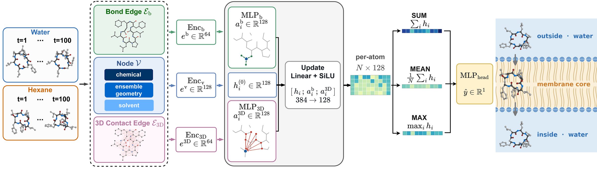

# CHEDDAR

Cyclic-peptide membrane permeability from solvent-dependent conformational ensembles.

Each peptide becomes two atom graphs, one per explicit-solvent MD ensemble (water and
hexane). Atom features are statistics over 100 frames rather than one structure, contact
edges are selected by how often a pair stays in contact, and the two solvent predictions are
averaged. The model has 554,561 parameters, trains in about 31 min on one GPU and predicts
in 2.3 ms per peptide.

**Start with [Setup](#setup)**, which every other command on this page depends on. Then:

| if you want to | go to | needs |
| --- | --- | --- |
| predict permeability for a peptide | [Obtaining a prediction](#obtaining-a-prediction) | CPU, seconds |
| reproduce the paper's numbers | [Evaluating the model](#evaluating-the-model) | CPU, ~3 min |
| rebuild the models from scratch | [Training the model](#training-the-model) | **GPU**, 31 min each |
| change a hyperparameter or run an ablation | [Tuning and ablations](#tuning-and-ablations) | GPU |

Background on the problem and the model is in [Cyclic peptide permeability
prediction](#cyclic-peptide-permeability-prediction) and
[Architecture](#architecture); what is in the repository and where the data came
from are in [Repository contents](#repository-contents) and [Data](#data).

## Cyclic peptide permeability prediction

A cyclic peptide is a short peptide whose backbone is closed into a ring. The class combines
broad interaction surfaces with conformational constraints that can improve resistance to
proteolysis, which makes it attractive for targets that conventional small molecules struggle
to address. Many cyclic peptides, however, have limited passive membrane permeability, which
restricts access to intracellular targets and contributes to poor oral absorption. Predicting
permeability is therefore a useful step in identifying promising candidates, particularly for
scaffolds beyond those already measured.

Permeability here depends on chemical composition and on whether polar groups are exposed or
shielded, which can change substantially with stereochemistry. Solvent-dependent
conformational preferences allow a molecule to expose polar groups in the aqueous environment
around the membrane while favouring intramolecular hydrogen bonding and polar-group burial in
its nonpolar core, a behaviour termed molecular chameleonicity. A representation of the
molecule therefore has to cover both environments and describe the conformational
distribution within each. CHEDDAR does this by reading independently sampled explicit-solvent
ensembles in water and in hexane, and predicts `log P_app` as measured by a PAMPA assay.

## Architecture



A peptide enters as two graphs, one per solvent, sharing nodes and bonds and differing only
in the geometry read off the water and hexane ensembles and in the solvent token carried on
every node. Atom features combine a chemical block, an ensemble-geometry block and that
token; bonded and 3D-contact relations carry disjoint feature blocks and separate encoders
and message MLPs, so their aggregates reach the node update without being merged. Pooling
concatenates the sum, mean and maximum statistics and leaves their weighting to the head,
which is bounded to the normalized label range. The two views are never compared inside the
model -- each contributes its own loss term -- and are averaged only at inference.

## Setup

Do this once, before anything else on this page. Predicting, evaluating and training all
read the same two feature caches, which are built from MD trajectories that a fresh clone
does not contain, so all three need these steps first.

```bash
conda env create -f environment.yml && conda activate cheddar   # 1. install, about 3 min
python -m cheddar check                                         # 2. report what is present
python -m cheddar data                                          # 3. obtain the MD data, 1.6 GB
```

Step 3 is the only lengthy one: it downloads 1.6 GB, unpacks it to 10.2 GB and needs about
12.5 GB of free disk while doing so. It is performed once. Step 2 reports which files are
present and which are missing, and step 3 exits immediately if the trajectories are already
there, so neither costs anything when it is not needed.

The first command that reads the data then builds the two caches from the trajectories,
about 72 s each, printing what it is doing as it goes. Later commands reuse them and start
in seconds. Note that skipping step 3 does not fail with a message about missing data: the
1.6 GB download simply begins by itself, which is worth knowing before a command that looks
like it has hung.

A GPU is needed only for training. Predicting and evaluating run on a CPU.

## Obtaining a prediction

```bash
./predict.sh 5222
```

`5222` is a CycPeptMPDB identifier; any number of identifiers may be given, and
`./predict.sh` with no arguments runs a worked example. The output has the following
form:

```
id          logPapp     sd   measured partition
5222          -5.43   0.05      -5.25 test

5222: predicted log P_app -5.43, above average permeability for a cyclic peptide
   -- more permeable than 68% of the 4925 measured ones.
   measured -5.25, so this prediction is 0.18 log units off.
```

### Interpreting the output

`log P_app` is the base-10 logarithm of the apparent permeability coefficient in cm/s, as
measured by a PAMPA assay. It is negative throughout, and **less negative indicates greater
permeability**: −5.0 denotes a peptide that crosses readily, −7.0 one that crosses poorly.
Since an absolute log unit is difficult to place in context, each prediction is additionally
ranked against the 4,925 peptides carrying a measured value, this being the only scale on
which the model was fitted.

`sd` is the standard deviation across the five independently trained models provided here. A
small `sd` indicates agreement among the five; a large one indicates that the peptide falls
where they disagree, and the prediction should be weighted accordingly.

Each prediction is the five averaged into one, which is also how the figures under
[Evaluating the model](#evaluating-the-model) are obtained.

`partition` indicates whether the peptide belonged to the training set of the model used. A
value of `train` means the figure is in-sample and correspondingly optimistic. The option
`--split OOD` selects a model that has not encountered the scaffold:

```bash
./predict.sh 4705 --split OOD
```

`./predict.sh` is a thin wrapper over `python -m cheddar predict` and accepts the same
arguments: `--partition test` for an entire partition, `--all` for every peptide, and
`--out results.csv` to write the results to a file.

Should anything appear incorrect, `python -m cheddar check` reports the installed versions,
the visible GPU and the data files located, without executing any computation.

## Evaluating the model

This reproduces the paper's main result. It scores the fifteen checkpoints in `ckpts/`, so
no training is required.

```bash
python -m cheddar eval     # equivalently, just: python -m cheddar
```

`eval` is the default command, so it may be omitted. No arguments or paths are required.
Scoring all fifteen takes about three minutes, most of it spent reading the two caches, and
runs on a CPU. The output is

```
split       n  MSE              R2
ID          5  0.145 +- 0.003    0.621 +- 0.007
OOD         5  0.236 +- 0.018    0.660 +- 0.026
Cliff       5  0.142 +- 0.003    0.683 +- 0.006
```

corresponding to the CHEDDAR row of Table 1, as the mean and standard deviation over seeds
1, 2, 7, 13 and 42, followed by the same result stated in prose. The three splits are the
random (`ID`), Bemis–Murcko scaffold (`OOD`) and activity-cliff (`Cliff`)
partitions described in Appendix C.

Adding `--ensemble` averages the five seeds of each split into a single prediction per
peptide and scores that prediction once, which is what `predict.sh` returns:

```bash
python -m cheddar eval --ensemble
```

```
split       n  seeds  MSE      R2       MAE
ID        492      5  0.138    0.638    0.252
OOD       490      5  0.219    0.685    0.360
Cliff     493      5  0.136    0.697    0.252
```

Retraining from scratch yields the same figures. `python -m cheddar sweep` rebuilds all
fifteen models from random initialisation and reproduces the first table above in both mean
and standard deviation, each resulting `best.pt` being byte-identical to the checkpoint
provided here.
Two limitations of this check should be noted: it constitutes a deterministic replay on the
same GPU architecture and PyTorch build rather than an independent reimplementation, and it
covers the CHEDDAR row alone, as the seven baselines of Table 1 are not included in this
repository.

## Training the model

Training is not required in order to use CHEDDAR: the fifteen models behind the paper are
already in `ckpts/`, and both `predict.sh` and `eval` use them directly. This section is for
rebuilding them. **A GPU is needed here**, unlike everywhere else on this page.

One model, about 31 minutes on one GPU:

```bash
python -m cheddar train --split ID --seed 1
```

All fifteen, which is how the paper's table was produced:

```bash
python -m cheddar sweep
```

`--split` is one of `ID`, `OOD` or `Cliff` and `--seed` one of 1, 2, 7, 13 and 42; the
fifteen models are every combination. A single run writes `test_metrics.json`,
`history.json`, `predictions.csv` and `best.pt` to `runs/cheddar-<split>-s<seed>/`, and
`sweep` simply runs all fifteen of them.

`sweep` uses only GPUs that are not in use by others, limits itself to 80 % of the available
cores, and skips runs for which results already exist, so an interrupted sweep resumes where
it stopped. Deterministic kernels are enabled, so a given seed on the same GPU architecture
and PyTorch build reproduces its result exactly, including a byte-identical `best.pt`.

On eight RTX 3090s, `sweep` assigns one card per run, so the fifteen proceed in two waves
and finish in 69 min. Placing all fifteen on the eight cards at once, two per card, took
51 min: 20–26 s per epoch, plus about 8 min at the outset while fifteen processes read the
same two 1 GB caches from one disk. A run peaks at 0.72 GB of GPU memory, so sharing a card
costs speed alone.

### How training works

**Objective.** The model is fitted by stochastic gradient descent on the measured
permeabilities of the training peptides, minimising mean squared error on the scaled label.
A single pass over the training set is one epoch, and the budget is fixed at 120 epochs. No
conformational search or docking is performed at training time; the conformational ensembles
are inputs, computed in advance.

**Partitioning and model selection.** Each split divides the peptides into training,
validation and test sets. Parameters are fitted on the training set, the checkpoint is
selected by validation mean squared error on the original log P_app scale, and the selected
checkpoint is evaluated once on the test set, which is not consulted during fitting or
selection. The test figures are what Table 1 reports.

**Replication.** Initialisation and batch order depend on the random seed, so each
configuration is run with five seeds (1, 2, 7, 13, 42) and reported as a mean with its
standard deviation, which separates the effect of the method from seed variance.

## Tuning and ablations

`configs/cheddar.json` contains every hyperparameter of the released model. It may be
copied, modified as required and supplied via `--config`.

```bash
python -m cheddar sweep --config configs/abl_water_only.json
python -m cheddar train --config configs/abl_no_contact_edges.json --split ID --seed 1
```

| key | meaning | released |
| --- | --- | --- |
| `hidden`, `head_hidden` | width of the message passing and of the head | 128, 128 |
| `layers` | message passing layers | 3 |
| `dropout` | dropout in the encoder and head | 0.5 |
| `trans_drop` | p_drop of Eq. (7), dropout on transient contact edges | 0.2 |
| `lr`, `weight_decay`, `warmup_frac` | OneCycle peak, AdamW decay, warmup share | 6e-4, 0.1, 0.2 |
| `batch_size`, `epochs` | batch and the fixed epoch budget | 16, 120 |
| `edge_block` | `both` or `bond` to drop the 3D contact relation | both |
| `both_solvents`, `solvent_token` | use two solvent views, append iota_s | true, true |
| `meanonly` | remove the dispersion columns outright, which changes the feature width and the parameter count | absent |
| `mask_node_cols`, `mask_space_cols` | withhold named columns by setting them to 0.0 after standardization, leaving the feature width and the parameter count unchanged | absent |
| `cache`, `alt_cache` | the two solvent caches; a name containing `meanedge` is built with the mean-distance rule of Eq. (6) instead of occupancy | ensemble_{Water,Hexane} |

The `abl_*.json` files provided correspond to the arms of Table 2, so each row of that table
amounts to a single sweep. Runs are named after the configuration, for example
`runs/abl_water_only-ID-s1/`.

The "w/o ensemble geometry" row was produced by masking, which is what
`abl_no_ensemble_masked.json` reproduces: the seven dispersion columns on the node and the
six on the 3D contact relation are set to 0.0 after standardization, so the model keeps its
554,561 parameters and only the information is withheld. `abl_no_ensemble_geometry.json`
takes a different route, removing those columns and reading a mean-distance-selected cache,
which changes the feature width and does not reproduce the published figure.

## Repository contents

```
predict.sh   single-command prediction, the entry point most readers require
cheddar/     __init__.py  marks the package, empty
             __main__.py  the command line; `python -m cheddar --help` lists every command
             fetch.py     find the trajectories, or download the Zenodo record
             features.py  cache construction from MD frames, split and label IO
             data.py      cache reader, standardization, label scaling
             model.py     the network
             train.py     training loop and evaluation
             sweep.py     the 3 x 5 grid across free GPUs
             eval.py      score checkpoints without training
             predict.py   permeability for named peptides
configs/     cheddar.json  every hyperparameter of the released model
             abl_*.json    the arms of Table 2
ckpts/       the 15 checkpoints behind the paper's main table
data/        label table, atom annotation, the three splits, a SMILES correction
cache/       built on first use from the trajectories; not shipped, not tracked
environment.yml  the exact versions every number in the paper was produced with
LICENSE      MIT
```

## Data

The label table, the atom annotation and the three split files are included here. The MD
trajectories are not; they constitute the public CycPeptMPDB-4D release, 1.6 GB compressed
and 10.2 GB unpacked, available at https://zenodo.org/records/21274695 .

No configuration is necessary. `python -m cheddar data` searches the customary locations for
an unpacked copy, downloads and unpacks the record if none is found, resumes an interrupted
download and verifies the published MD5. If the copy resides in a non-standard location,
`CHEDDAR_TRAJ` may be set to the directory containing `Water/` and `Hexane/`, and
`CHEDDAR_NO_DOWNLOAD=1` prevents any network access. Approximately 12.5 GB of disk is
required during unpacking and 10.2 GB thereafter, once the archive is removed.

The release is read exactly as it unpacks, from `Water/Trajectories/*_Traj.pdb` and the
corresponding hexane path, so no conversion is necessary. Both solvent caches are built on
first use and together occupy 1.9 GB, requiring approximately 90 s each on 32 cores: some
20 s to compute the features for the 4,925 peptides and the remainder to write a gigabyte
to disk. They are derived files and may be deleted at any point, the next command rebuilding
them; a rebuild reproduces every feature array bit for bit, so the results above do not
depend on retaining any particular copy. Only the `.pkl` framing may shift by a few hundred
bytes, which nothing reads.

Two points merit attention. The release contains 5,160 peptides whereas the model uses the
4,925 for which an atom annotation is provided here; the remaining 235 are skipped, which is
expected and does not indicate an error. In addition, an earlier release of the same data
stores coordinates in nanometres, under which the 5 A contact cutoff would render every atom
pair a contact; the builder verifies the units and declines to proceed rather than producing
silently incorrect features.

`data/nal_fix.json` corrects 95 peptides whose tabulated SMILES specifies
2-naphthylalanine while the deposited geometry is 1-naphthylalanine. It is applied
automatically; without it, those 95 molecules receive atom features inconsistent with their
own trajectory.

## License

MIT, see LICENSE.
